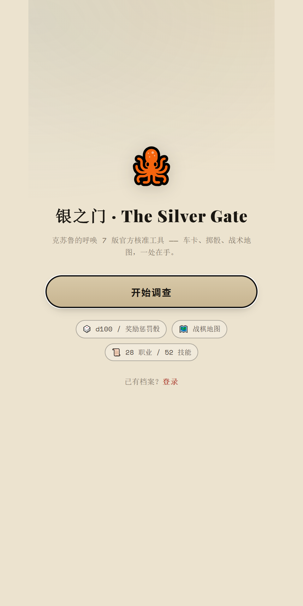
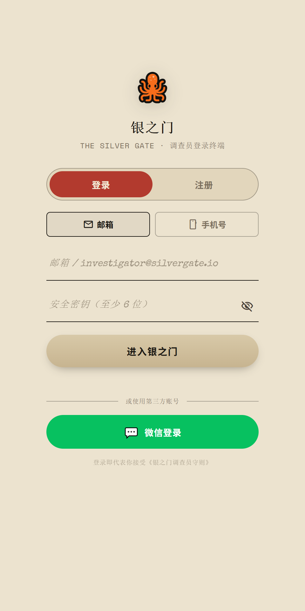
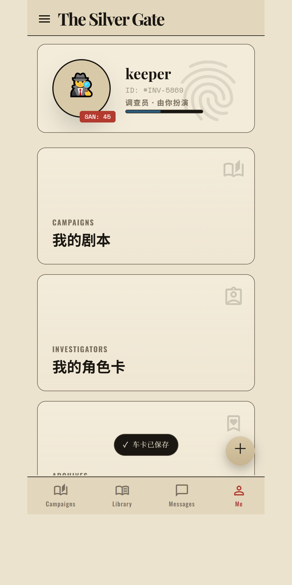
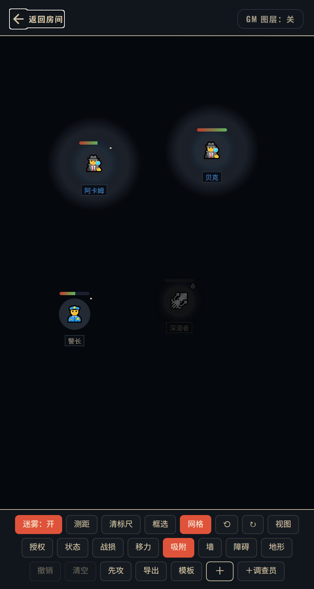
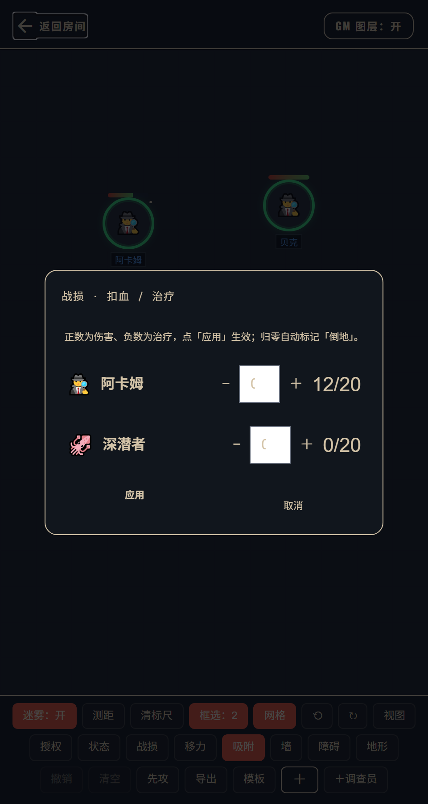

<div align="center">

# Silver Gate

**An AI-keeper Call of Cthulhu tabletop app whose entire codebase ships as one HTML file.**

No framework · No runtime deps · Double-click to play · Built-in AI Keeper · 8-module dependency-graph-validating build

### [▶ Play it live (no install, no signup)](https://sunred-liu.github.io/silver-gate/)

[](LICENSE)
[](https://github.com/sunred-liu/silver-gate/actions/workflows/ci.yml)
[](#-delivery-shape)
[](#-delivery-shape)

[中文](README.md) · [Architecture](docs/ARCHITECTURE.md) · [Security](docs/SECURITY.md)

    

</div>

---

## What it is

A tabletop companion for *Call of Cthulhu* — character sheets, dice checks, campaign rooms, battle maps, an AI Keeper, and character progression — all inside **one HTML file**. Works offline. Add a small Node server when you want multiplayer.

It started as "put my home game on my phone". Then it grew into something slightly unreasonable: **no frontend framework, yet the source is split into 8 modules / 35 chunks / 395 symbols, and a build script validates the dependency edges between them on every build.**

That sounds like over-engineering. It is. But it buys two real things:

- **All code lives in one HTML file** (`www/index.html`, 612KB: every module, every style, every view). No node, no bundler, no CI needed to *run* it. The style library, fonts and background art sit next to it as plain static files (see [Delivery shape](#delivery-shape)); if they're missing the UI degrades but the app still works.
- **The source never turns into spaghetti.** Adding a feature? Edit `src/`, and the build tells you *"you used a symbol owned by `m6-map`, but `m3-ai` doesn't declare that dependency."* Not by convention — by failure.

---

## Why it might interest you

### 1. A build script that draws your dependency graph

`build.js` is not a bundler wrapper — it is an **architecture check**. It slices sources on `/*@@ mod:chunk @@*/` sentinels, statically scans top-level declarations to map symbols to modules, then verifies "who references whose symbols — is that edge declared in `modules.json`?" Each build prints the graph:

```
模块 8 个 / 分块 35 个 / 符号 395 个
  m0-core  L0 src/m0-core.js       分块 state,helpers,renderers,date
  ...
依赖边: m0-core->m5-net  m1-character->m0-core  ...
  [info] 依赖环：m0-core ↔ m1-character ↔ ... (强连通分量 7 个模块，19 条边)
产物: www/index.html  626848 B  md5=edcc8ba5...
```

The cycle it prints is **real and not hidden**. `m0-core`'s renderer reads the logged-in username (owned by `m5-net`), and `m5-net` calls the renderer back. Fully decoupling needs an event bus — that's a bigger refactor. Rather than pretend the architecture is clean, the build prints the cycle every time, and `modules.json` documents each reverse edge with *which line, why, and which batch will fix it*.

There's also a `scanIgnore` mechanism worth stealing: `m6-map` has `const ck=cellKey(...)`, which static analysis misreads as a reference to `m1-character`'s top-level `ck`. Instead of an inline disable comment, `modules.json` records the exemption **with its justification** — *"exemptions are allowed, but they must be documented."* That survives real projects better than "no exceptions."

### 2. A zero-dependency QR encoder (9.7KB)

`src/m7-qr.js`, 9,728 bytes, zero outgoing edges. Implements ISO/IEC 18004 byte mode yourself: EC level M, versions 1–9, all 8 masks scored by the standard penalty rules.

Why hand-roll it? Because "scan to join a room" **doesn't justify a CDN dependency** — that would break the "single file, works offline" premise. It's the most self-contained piece in the repo and the easiest to lift out: copy the file, done.

### 3. AI Keeper: offline rule brain + online LLM, with automatic fallback

| Mode | How | Network |
|---|---|---|
| `local` | **Rule brain**: classifies scene keywords (hospital / mansion / town / cult / campus…), generates NPCs & clues via "truth-first + three-clue rule" | ❌ |
| `remote` | Any **OpenAI-compatible** endpoint (URL + key + model) | ✅ |
| server brain | Talks to `server/ai-engine.js` `/ai/*`, with usage accounting | ✅ |

The important part is **silent fallback**: when the remote call fails or you're not logged in, it degrades to the local brain without an error dialog and without stopping the game. A tabletop app that keeps running when your friend's Wi-Fi dies matters more than one more model integration.

---

## Quick start

**Easiest — just open it:**

```bash
git clone https://github.com/<your-name>/silver-gate.git
cd silver-gate
open www/index.html        # macOS   (Windows: start www\index.html)
```

No `npm install`. `www/index.html` is a **pre-built artifact**, playable as-is.

> ⚠️ Under `file://` some browsers restrict `localStorage`/`fetch`. For the full experience use a static server.

```bash
npx serve www            # or: python -m http.server -d www 8080
```

**Multiplayer backend:**

```bash
cd server && npm install
JWT_SECRET="a-random-32-char-string" node index.js   # http://127.0.0.1:3000
```

---

## Delivery shape

```
src/index.shell.html ──┐
src/m0…m7.js ──────────┼─→ node build.js ─→ www/index.html ─→ static host / APK / all tests
modules.json ──────────┘        ↑
                          (validates dependency edges too)
```

| Metric | Value |
|---|---|
| Code artifact | **626,848 B single HTML (~612KB)** — all 8 modules, styles, views |
| Static assets | `www/vendor/` 7.8MB (Tailwind 419KB + fonts 7.4MB) · `www/bg/` 11MB (5 backgrounds) |
| Runtime deps | **0 npm packages** (Tailwind and fonts are local files, no CDN) |
| Source | 8 modules / 35 chunks / 395 top-level symbols |
| Build deps | Node ≥ 18 (only `fs`/`path`/`crypto`) |
| Backend (optional) | `ws` + Node http |

---

## Modules

| Module | Layer | Responsibility |
|---|---|---|
| **m0-core** | L0 | Global state / DOM helpers / message & dice rendering / dates |
| **m2-dice** | L1 | CoC checks (bonus/penalty dice), generic rolls |
| **m7-qr** | L1 | Zero-dep QR encoder |
| **m4-content** | L1 | Built-in scenario constants, local scenario library |
| **m1-character** | L2 | Sheet creation, stat rolls, age modifiers, import/export, **full lifecycle** (tags / fate fragments / offline growth / interlude growth / tiers T1–T5) |
| **m5-net** | L2 | Persistence, REST, cloud saves (LWW merge + tombstones), WebSocket room sync, auth/JWT, share links |
| **m3-ai** | L3 | Provider abstraction, scenario archetypes, AI Keeper, AI teammate, settings, server brain |
| **m6-map** | L3 | Wargame board: wall/terrain editing with undo, token permissions, initiative, damage timeline, **fog + VBL line-of-sight**, pathfinding with movement budget |

Full graph, chunk list and exemption rationale in [docs/ARCHITECTURE.md](docs/ARCHITECTURE.md).

---

## Roadmap

- [x] 8-module split + dependency-edge validation + drift sentinel
- [x] Zero-dep QR encoder
- [x] AI Keeper: local brain + OpenAI-compatible remote + fallback
- [x] VBL line-of-sight & fog
- [ ] **Break the 7-module cycle** via an event bus
- [ ] Split `m5-net` into storage vs. network
- [ ] Scenario DSL — write your own campaign in plain text
- [ ] Mobile gestures polish

---

## Known limitations (please read)

1. **Prototype, not a product.** Data lives in `localStorage`; clearing it loses your saves. Cloud saves need the backend.
2. **Offline tokens are not a security boundary.** Signed and verified by the frontend itself; anyone can forge them. Real auth only exists in multiplayer mode (server-signed).
3. **Password hashing is un-salted djb2.** Fine for distinguishing local profiles; **unusable in production**. See [docs/SECURITY.md](docs/SECURITY.md).
4. **Built-in scenarios store metadata only** (title/players/duration/original link) — no copyrighted text.
5. Some visuals reference external fonts/placeholder images; offline it falls back to system fonts.

---

## Contributing

See [CONTRIBUTING.md](CONTRIBUTING.md). Short version:

```bash
node build.js && node test/check.js
```

**Never edit `www/index.html` by hand** — it's generated. We welcome cycle-breaking, performance, mobile gestures, and docs. We won't merge a React rewrite or a multi-file deployment: single-file zero-dependency is the constraint, not the debt.

---

## Legal

Non-commercial fan project, not affiliated with Chaosium Inc. *Call of Cthulhu* and related rules belong to Chaosium Inc. No commercial scenario text is bundled. Code is [MIT](LICENSE).
